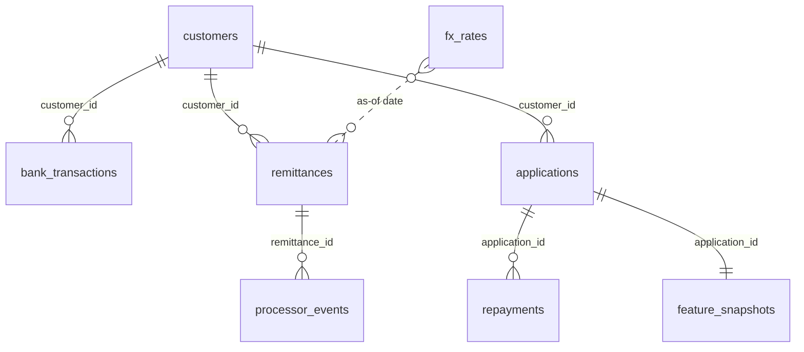

# Newcomer Credit Data Platform

Picture this...

A nurse moves from Nairobi to Manchester. She has a steady salary, pays her rent on time, and sends money home every month. A UK lender still sees almost nothing, because her credit history stayed behind when she left.

This project builds the system a lender would need to see her clearly. It gathers her everyday financial records. These includes her salary coming in, her bills going out, the money she sends home. It turns them into a fair picture of what she can afford. And it makes sure that picture is built only from what the lender could have known on the day they made their decision.


> [!IMPORTANT]
> **This is a data engineering portfolio project**. It is not a credit-risk model, and nothing here should be used to approve, decline, price or rank a real customer.

## Contents

- [Read this repo in five minutes](#read-this-repo-in-five-minutes)
- [Quick start](#quick-start)
- [How it works](#how-it-works)
- [Why I had to Synthesise the Data](#why-I-had-to-Synthesize-the-Data)
- [How the tables fit together](#how-the-tables-fit-together)
- [Feature definitions](#feature-definitions)
- [Point-in-time correctness](#point-in-time-correctness)
- [Test evidence](#test-evidence)
- [Design Decisions I Made](#design-decisions-I-made)
- [What doesn't work yet](#what-doesnt-work-yet)
- [Repository layout](#repository-layout)
- [Responsible use](#responsible-use)
- [Why I built this](#why-i-built-this)
  
---

## Read this Repo in Under Five Minutes

If you only have a few minutes, look at these three things in order.
 
1. **[`tests/temporal/test_point_in_time.py`](tests/temporal/)** shows that a transaction arriving after a decision can never change that decision's features. This is the hardest problem in the project.
2. **[`docs/defect_log.md`](docs/defect_log.md)** records every defect I deliberately planted, the test that caught it, and the fix.
3. **[`docs/feature_validation.md`](docs/feature_validation.md)** shows whether customers the features rated as affordable actually repaid more often.

---

## Quick Start

You need Python 3.12, PostgreSQL 17 running locally and `make`. It runs comfortably on a 16GB laptop.
 
```bash
git clone https://github.com/<your-username>/newcomer-credit-platform
cd newcomer-credit-platform
cp .env.example .env      # add your local Postgres connection details
 
make setup    # create a virtual environment and install dependencies
make seed     # generate the synthetic population (same output every run)
make run      # ingestion, dbt models and quality checks via Dagster
make serve    # start the feature API on localhost:8000
make test     # run pytest and dbt tests
```
Then try it:
 
```bash
curl localhost:8000/features/application/APP-000042
```

## How it Works


Raw data is never overwritten. Every derived table can be traced back to its source records through dbt docs and the Dagster asset graph.

**Stack**: Python, PostgreSQL, dbt Core, Dagster, FastAPI, pytest and GitHub Actions.

## Why I had to Synthesize the Customer Data

Real lending data is private, and that's how it should be. So the core of this project runs on a synthetic population that I generate, with one important twist.
 
Every synthetic customer is created first, before any of their data. The generator decides when they arrived and how they earn. It decides what they pay in rent and whether they send money home. Then it gives each person a hidden **true affordability** score that never appears in any table the pipeline can see.
 
Everything else is generated from that profile. Transactions, remittances, loan applications and repayments all flow from who the customer is. On top of that, the generator plants problems on purpose. Some records arrive late. Some are duplicated. Some transfers fail or get reversed. Merchant names come through messy.
 
This gives the pipeline something real to prove. If the features work, customers they rate as affordable should repay more often. If future data leaks into past decisions, the results come out suspiciously perfect, and that becomes its own alarm.
 
**What this proves, and what it doesn't.** It proves the pipeline can recover a real signal from messy, late and conflicting data. It says nothing about how actual newcomers manage money, because repayment behaviour comes from my generator's assumptions. That limit is deliberate and stated, not hidden.
 
A separate public credit dataset sits alongside the synthetic world as a real-data module. It never joins to the synthetic customers. Its job is to show the pipeline handling data nobody designed.
 
| | |
|---|---|
| Customers | `TBD` |
| Transactions | `TBD` |
| Deterministic across runs | Verified in CI: `TBD` |
 
---

## How the Tables Fit Together 

Everything hangs off one key: `customer_id`. That's what makes the synthetic world joinable from the first transaction to the final repayment.
 

 
Two tables are deliberately kept away from features. `repayments` holds outcomes that happen after a decision, so it only joins later, to check whether the features worked. `generator_truth` holds the hidden affordability scores and is used only to grade the pipeline.
 
---
## Feature definitions

Every feature has a written definition and a version number. Changing a definition takes a pull request, passing tests, and an entry in [`features/CHANGELOG.md`](features/CHANGELOG.md) showing the old and new values side by side.
 
| Feature | Definition (v1) |
|---|---|
| **Income regularity** | Credits from the same source arriving every 25 to 35 days, at least three times in six months, with amounts within 20% of the median. Reports how often income arrives and how much it varies. |
| **Recurring obligations** | Payments to the same recipient at least three times in six months on a regular rhythm. Each one is tagged with a category and a confidence score. |
| **Estimated disposable income** | Average monthly eligible income minus average monthly recurring obligations over the lookback window. |
| **Remittance summary** | How often someone sends money, how much, what it costs, and how often it fails. Descriptive only. Sending money home is never treated as proof of anything. |
 
These thresholds are starting assumptions. I expect to revise them, and every revision is logged.
 
---

## Point-in-time Correctness

This is the part of the project I care about most.
 
When a lender decides on an application, they can only use what they knew at that moment. A pipeline that quietly uses later data produces features that look brilliant in testing and fail in real life.
 
Every transaction here carries three timestamps:
 
- **Event time:** when the transaction happened
- **Booking time:** when the bank recorded it
- **Ingestion time:** when this pipeline received it
A feature for an application decided on 1 June can only use records the pipeline had received by that moment. A payment that happened in May but arrived on 15 June does not count.
 
The platform answers two questions separately.
 
**What did we know at decision time?** Features are frozen at the moment of decision into an append-only table. They never change afterwards.
 
**What do we know now?** Features can be recomputed for any date using everything available today.
 
The gap between the two shows how much late data would have changed a decision. Exchange rates follow the same rule: a remittance only ever uses a rate that was published before it.
 
---

## Test evidence
 
A green checkmark proves nothing on its own. Every result below comes from a test that checks a specific value, and the key tests were proven by planting the bug they guard against.
 
**Current totals:** 28 Python tests (12 generator, 10 loader, 6 API) and 26 dbt checks, including 2 unit tests. All passing.
 
| Area | What the tests prove | Result |
|---|---|---|
| Generator | Same seed gives byte-identical files. IDs are unique. No transaction before a customer arrived. The hidden truth never appears in visible tables. | Pass (12 tests) |
| Loading | Row counts match the manifest. Loading twice inserts nothing. Every attempt is logged. Every row links to the run that loaded it. | Pass |
| Bad input | A tampered file (checksum mismatch) is refused and logged. A renamed column is refused. One bad value rolls back the whole file. | Pass |
| Exactness | Money totals match to the penny after loading. Timestamps keep their UTC meaning. | Pass |
| Data quality (dbt) | Keys unique and not null. Every transaction and application belongs to a known customer. Direction is only credit or debit. | Pass |
| Point-in-time | No income visible after the decision reaches the feature. A late-arriving payment is excluded. | Pass |
| Feature logic | Hand-made cases: steady salary is regular; gig income, too few payments, inconsistent amounts and no income are not. Every application has exactly one feature row. | Pass |
| API | Known ID returns the feature. Unknown ID returns 404. Malformed ID returns 422 without touching the database. Money is sent as an exact string. Timestamps are UTC. | Pass (6 tests) |
| Reconciliation, snapshots, orchestration, CI | | Planned |
 
### Planted bugs, and what caught them
 
| Planted bug | Caught by |
|---|---|
| Removed the arrival-date check from the generator | `test_no_transaction_before_arrival_or_after_sim_end` |
| Removed the seed from the generator | Both determinism tests |
| Removed `ON CONFLICT DO NOTHING` from the loader | `test_loading_twice_creates_no_duplicates` and two others |
| Disabled the checksum check | `test_tampered_file_is_refused_and_logged` |
| Deleted the point-in-time rule | The late-arrival unit test, and the guard test (6,211 future rows) |
| Swapped `available_at` for `event_at` | The late-arrival unit test, and nothing else |
| Loosened the 20% amount rule to 60% | The feature unit test |
 
---
 
## Design decisions
 
A few choices that shaped the project, and why.
 
**PostgreSQL instead of Snowflake.** It's free, runs locally and keeps the project reproducible for anyone. dbt keeps the SQL portable, so a cloud warehouse later is a configuration change, not a rewrite.
 
**One synthetic world instead of several datasets.** An earlier version of the plan stitched together public datasets that described different people. Nothing could join, so nothing could be validated. One linked population fixed that.
 
**Load through a temporary table.** Files land as plain text first, then get converted and deduplicated on the way into the real table, inside one transaction. A bad value can't leave half a file behind.
 
**Unit tests for what the data can't show.** v1 data has no late payments and no irregular income, so tests on real data can't prove those cases work. dbt unit tests with hand-made rows can, so those rules are protected now, before v2 data arrives.
 
**The API reads, never computes.** dbt computes and tests the feature once. The API only reads the finished table, so the two can never disagree.
 
**UTC everywhere.** The generator writes UTC, models convert to UTC explicitly, and the API pins its connections to UTC. Answers never depend on where a machine happens to be.
 
---
 
## What doesn't work yet
 
This section is honest by design. If something is missing, simplified or limited, it's here.
 
- **Every application currently comes out as having regular income.** Generator v1 only creates salaried customers, so this is true of the data, not a flaw in the feature. The "not regular" logic is proven with unit tests until v2 adds gig income.
- **v1 data can't exercise late arrivals.** `event_at` and `available_at` are always equal. A unit test covers the rule in the meantime.
- **Only one feature exists.** Recurring obligations and disposable income come next.
- **No frozen snapshots yet.** The feature table is rebuilt on every run.
- **No orchestration or CI.** The pipeline runs through `make`. Dagster and GitHub Actions are planned.
- **The API opens a new database connection per request.** Fine for a demo; a real service would use a connection pool.
- **No validation against outcomes yet.** Repayments and the hidden truth aren't used for evaluation yet. When they are, the loop will be partly circular: features and outcomes both come from the generator's assumptions.
---
 
## Repository layout
 
```
generator/                 seeded synthetic population (build.py logic, run.py files)
ingestion/                 the loader
sql/                       database bootstrap, schemas and raw tables
dbt/
  models/staging/          clean and standardise each source
  models/intermediate/     income known at decision time, gaps between payments
  models/marts/            feat_income_regularity
  tests/                   custom tests, including the point-in-time guard
  macros/                  schema naming
api/                       FastAPI feature service
tests/                     generator, ingestion and API tests (pytest)
features/                  CHANGELOG.md: feature definitions and versions
scripts/                   setup checks
data/                      generated data (not committed)
```
 
---
 
## Responsible use
 
This is not a credit-risk model. The only identities in the system are synthetic, and synthetic behaviour reflects my generator's assumptions, not real people.
 
The generator never creates nationality, immigration status or ethnicity, so those can never become features. Remittance behaviour will be reported descriptively, never as a stand-in for whether someone will repay. Any real lending use would need legal review, privacy and security controls, model validation, fairness testing, explainability and human oversight.
 
---
 
## Why I built this
 
I studied actuarial science, so I spent years learning how lenders and insurers think about risk. Now I'm moving into data engineering, and I wanted my first serious project to sit right where those two worlds meet.
 
The problem also isn't abstract to me. Plenty of people I know have moved abroad with solid financial lives and arrived as strangers to the local credit system. This project is my attempt to understand, from the data side, what it would take to see them clearly.
 
I'm documenting the build as I go:
 
1. [Before the First Pipeline](https://jimmyokoth.com/blog/setting-up-a-data-engineering-project): setting up the project base
2. [Fake Data, Real Discipline](https://jimmyokoth.com/blog/fake-data-real-discipline): the seeded generator
3. [From Files to Tables](https://jimmyokoth.com/blog/from-files-to-tables): the loader
4. [Every Test Passed. The Bug Was Still There.](https://jimmyokoth.com/blog/every-test-passed): the first feature, end to end
---
 
**Jimmy Okoth** · Nairobi, Kenya · [LinkedIn](https://linkedin.com/in/jimthedataguy) · [GitHub](https://github.com/themanbuildingpipelines) · [jimmyokoth.com](https://jimmyokoth.com)
